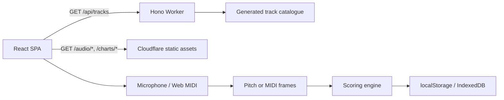

# PROJECT.md

A practical orientation guide for engineers and AI coding assistants. Read this first, then
the deeper documents linked at the bottom.

## What this is

Music Performance is a browser game. A player performs the melody of a backing track on an
instrument or with their voice, and the browser scores how closely they match the reference
chart on pitch, timing and note coverage.

The app is a React single-page application served as Cloudflare Worker static assets, with a
small Hono API for content metadata. Audio capture, pitch detection and scoring stay in the
browser; no recordings are uploaded.

## Current status

Phase 1 is playable: four tracks, microphone and Web MIDI input, live feedback, results,
local history, practice mode, pre-rendered keys, privacy controls and an offline PWA shell.

Phase work is deliberately separated:

- **Phase 1 (current):** curated pre-approved tracks, pre-computed charts, local-only
  persistence, one complete game loop.
- **Phase 2 (not started):** user MP3 uploads, instrument separation through fal.ai SAM
  Audio, server-side processing and chart extraction.
- **Phase 3 (future):** productisation, accounts, teaching UX and a larger library.

Do not add Phase 2 infrastructure to Phase 1 work.

## Quick start

Requires Node 22 or newer.

```bash
npm install
npm run dev
```

Open the URL printed by Vite (usually `http://localhost:5173`). Vite runs the real Worker
through `@cloudflare/vite-plugin`, so `/api/*` and the SPA work together. Microphone access
requires HTTPS or localhost.

Before calling work complete, run:

```bash
npm run lint
npm run typecheck
npm test
npm run build
```

For UI, audio, scoring or persistence changes, also run the browser checks:

```bash
npm run test:e2e
npm run test:e2e:pwa
```

Never deploy unless explicitly asked. The target Cloudflare account is pinned in
`wrangler.jsonc`.

## How the app is put together



- `src/client`: React screens, audio input, game lifecycle, practice playback, browser
  storage and the service-worker template.
- `src/shared`: platform-neutral domain types, chart/range logic, scoring and music maths.
- `src/worker`: Hono entry point and the generated catalogue. Only `/api/*` runs the Worker.
- `scripts/content`: build-time MIDI rendering, chart generation, catalogue generation,
  licence checks and validation.
- `content/`: source MIDI/voices, track manifests, provenance and the content lock.
- `public/`: rendered MP3s, charts, icons, notices, `_headers`, `404.html` and the built
  service worker.
- `e2e/`: Playwright browser, error-path, accessibility and production PWA tests.

### Screens and routing

The SPA uses hash routes because the Worker intentionally has no SPA fallback. Missing
assets and charts must return real 404s rather than `index.html`.

- Deep-linkable: `#/`, `#/setup`, `#/settings`, `#/history`, `#/results`, `#/pitch-lab`.
- Game and practice screens are transient state. Navigating away during a performance is
  blocked until the player forfeits.
- The current results payload is also written to `sessionStorage` so `#/results` can be
  refreshed without double-saving.

### Input and timing

`PitchSource` abstracts the two input methods in `src/client/audio/pitch.ts`:

- **Microphone:** `getUserMedia` plus a 4096-sample analyser and `pitchy` (McLeod Pitch
  Method). Noise suppression and AGC are disabled. Echo cancellation is on by default to
  reduce speaker bleed and can be turned off for headphones.
- **Web MIDI:** note-on/off messages are turned into frames with an explicit onset flag, so
  repeated notes can be distinguished from a held tone.

Both paths support cancellation, clean up late-resolving streams/access requests, and apply
the configured timing offset. Frame timestamps are corrected for the analysis-window centre
and browser-reported input latency. The `AudioContext` clock is the master clock for a
performance.

### Scoring

Scoring is monophonic and implemented as pure logic in `src/shared/scoring.ts`.

- Per-note score is multiplicative: pitch quality × timing quality × note coverage.
- Pitch is judged in cents with forgiving bands; timing uses onset windows and partial
  credit; coverage is time-weighted, not frame-count-weighted.
- Repeated same-pitch notes require a level dip/rise (re-articulation) for timing credit.
- Range forgiveness is octave-based plus vocal octave equivalence. Key selection uses
  pre-rendered -2/0/+2 semitone stems, and the chart is shifted only by the selected
  pre-rendered key.
- Guide-assisted runs are saved but excluded from clean personal bests.

The exact bands, weights and result breakdown are documented in
[`docs/003. PHASE-1-DESIGN.md`](docs/003.%20PHASE-1-DESIGN.md).

### Persistence and privacy

- `localStorage`: player name, last setup, audio volumes and timing offset.
- `IndexedDB`: results and personal bests. Bests are stored separately so retention pruning
  cannot delete them. The database has a versioned migration.
- `sessionStorage`: current results snapshot and tab-local diagnostics.
- Cache Storage / service worker: app shell, catalogue and played content.

There is no client analytics, remote error reporting or audio upload. "Privacy & data" in
the app reports what is stored and performs a best-effort clear of preferences, results,
caches and service-worker registrations.

## Decisions and why

| Decision                                            | Why                                                                                                   | Consequences                                                                                             |
| --------------------------------------------------- | ----------------------------------------------------------------------------------------------------- | -------------------------------------------------------------------------------------------------------- |
| Cloudflare Workers + static assets, not Pages       | One deployable with a small API surface and a clear path to Phase 2 server work                       | Only `/api/*` runs the Worker; everything else is static                                                 |
| Vite with the Cloudflare plugin                     | Local development runs the real Worker/Workerd environment                                            | `npm run dev` is the canonical dev server                                                                |
| React 19 + TypeScript + Tailwind 4 + Hono + Biome   | Small, typed stack with fast iteration and no runtime CSS layer                                       | Keep types strict; avoid adding dependencies without a reason                                            |
| Render our own backing from public-domain MIDI      | Melody can be muted, chart timings are exact, keys can be re-rendered, and the pipeline is repeatable | Timbres are synthesized rather than recorded performances                                                |
| Audited `melody.mid` as the chart source of truth   | Explicit source voices and manual review avoid heuristic top-voice errors                             | Never generate a chart from a heuristic when an explicit melody exists                                   |
| Public domain / CC0 / CC BY only                    | Keeps Phase 3 productisation options open                                                             | Reject NC, ND and SA assets, and any unclear provenance                                                  |
| MP3 stems, pre-rendered keys, JSON charts           | Broad browser support and no runtime rendering or transposition                                       | Semitone key changes must use a matching pre-rendered variant                                            |
| Octave-only range fitting, vocal octave equivalence | Shifting arbitrary semitones would move the target out of the backing key                             | Do not apply an arbitrary semitone shift to a chart without the matching audio                           |
| Multiplicative pitch × timing × coverage            | A note cannot score well by being loud, long or in tune alone                                         | Missing any dimension heavily penalises the note                                                         |
| Monophonic scoring                                  | Phase 1 is a melody game, not polyphonic transcription                                                | Chords and simultaneous notes are out of scope                                                           |
| Browser-only persistence                            | Privacy and Phase 1 scope; no accounts or storage backend                                             | Results are local to one browser and device                                                              |
| Microphone and MIDI behind one input abstraction    | The game loop and scoring should not care how frames arrive                                           | New inputs implement `PitchSource`                                                                       |
| Hash routing with real 404s                         | No SPA fallback, so missing charts/audio cannot masquerade as HTML                                    | New screens must add a hash route deliberately                                                           |
| Practice uses HTML media + Web Audio                | Pitch-preserving speed and metronome without requesting the microphone                                | Practice is separate from scored performance                                                             |
| Service worker versioned from assets + content lock | Content-only updates invalidate the shell cache automatically                                         | Catalogue/charts are network-first; hashed assets are cache-first; old caches are retained for open tabs |
| Generated content lock and validator                | Content, charts, variants and provenance must stay consistent                                         | Do not hand-edit generated catalogue or lock files                                                       |

## Invariants and gotchas

- `src/shared` must remain platform-neutral: no DOM, no Worker globals, no `fetch`.
- Browser audio, microphone, MIDI and storage code belongs in `src/client`.
- Charts and backing stems must stay aligned. A chart change usually means regenerating
  artifacts and updating the content lock.
- The melody is muted in the backing stem, but harmony can still contain melody pitch
  classes. Backing bleed can inflate scores; wired headphones are the practical setup.
- Never apply an arbitrary semitone transposition at play time. Use the pre-rendered keys
  so chart and audio move together.
- The audio clock, not `setInterval`, drives performance timing. Pause must suspend audio and
  the timer together.
- Results and bests use separate key/octave fields. Keep them separate when changing
  persistence or best-score semantics.
- A hash change during a performance must not silently unmount the game.
- Missing `/audio/*` or `/charts/*` must remain a 404, not the app shell.
- Update `public/_headers` and the service worker when changing security headers, the shell
  or cached content. The PWA test clears the HTTP cache before going offline.
- The FluidR3Mono soundfont is MIT-labelled upstream but its collection licensing is still
  under discussion. Treat the notices and legal review status as a release gate.
- Do not commit the soundfont. `npm run content:setup` downloads and verifies it.
- Keep diagnostics local-only. The pitch lab and diagnostics still ship in the app; do not
  add telemetry or remote logging without an explicit product decision.

## Common tasks

### Add or change a track

Follow [`docs/002. TRACK-CONTENT.md`](docs/002.%20TRACK-CONTENT.md). The short version:

1. Add `content/tracks/<id>/track.json`, source MIDI/LilyPond or `voices.json`, and
   `LICENSE.md` with exact provenance.
2. Create the audited `melody.mid` from an explicit voice.
3. Run `npm run content:setup` once, then `npm run content:build`.
4. Run `npm run content:validate`.
5. Verify the track in Setup and play it once before committing.

Never hand-edit `src/worker/catalog.generated.ts` or `content/content.lock.json`.

### Change scoring or range fitting

- Implement pure logic in `src/shared` with tests beside it.
- Update the phase design document if the scoring model or product behavior changes.
- Check both microphone and MIDI paths, repeated notes, octave equivalence, low frame
  rates and the pre-rendered key variants.
- Run unit tests, coverage and the browser flow.

### Add a screen or route

- Add it to `Screen` and both hash helpers in `src/client/App.tsx`.
- Lazy-load heavy screens.
- Return focus/scroll predictably, preserve keyboard access and re-run axe checks.
- If the screen can be refreshed, persist a validated snapshot rather than relying on
  component state.

### Change persistence or stored data

- Version the schema and add a migration or safe fallback for corrupt rows.
- Validate data read from `localStorage`, `sessionStorage` and IndexedDB; these stores are
  untrusted input.
- Keep personal bests independent of result retention.
- Test partial failures and clear-data behavior.

### Change the shell, PWA or security headers

- Update `public/_headers`, `public/manifest.webmanifest`, icons and the service-worker
  template as needed.
- Keep the cache version derived from hashed assets and `content.lock.json`.
- Add or update the production PWA test and the manual checklist.
- Confirm CSP, Permissions-Policy, HSTS, Referrer-Policy and frame protections still pass.

## Quality gates

| Gate                       | What it protects                                                           |
| -------------------------- | -------------------------------------------------------------------------- |
| `npm run lint`             | Biome lint/format across app, tests, scripts, JSON and CSS                 |
| `npm run typecheck`        | App, Worker, scripts and E2E TypeScript projects                           |
| `npm test`                 | Pure logic, game lifecycle, persistence, API, content gate and SW behavior |
| `npm run test:coverage`    | Enforced Vitest coverage thresholds                                        |
| `npm run test:e2e`         | Chrome flow, error paths, MIDI/practice/keys, mobile and axe               |
| `npm run test:e2e:pwa`     | Production preview, cold-cache offline reload and lazy chunks              |
| `npm run content:validate` | Lock hashes, regenerated charts, variants, catalogue, licences, notices    |
| `npm run cf-dry-run`       | Worker bundle builds without deploying                                     |

CI runs these in `.github/workflows/ci.yml`. Automated browser coverage is Chrome/Chromium
with synthetic input; real microphones, Safari, Firefox, iOS, Android and screen readers are
manual checks in [`docs/004. MANUAL-TESTING.md`](docs/004.%20MANUAL-TESTING.md).

## Deployment

- Worker name: `music-performance`.
- Target account: `707690ff96207f8c8eeef44fb9995ac7` (free plan), pinned in `wrangler.jsonc`.
- Build and deploy: `npm run deploy`.
- Validate without deploying: `npm run cf-dry-run`.

Deployment is an explicit action. Do not deploy, publish a release or change account
configuration without being asked.

## Known limitations

- Scoring is monophonic.
- Note names and instrument ranges are concert pitch. Guitar sounds an octave below written
  notation, so written music needs an octave adjustment.
- Backing arrangements are synthesized, not instrument-specific recordings.
- Input latency is estimated from the analysis window and browser latency, plus a manual
  offset; there is no measured calibration flow yet.
- Backing bleed from speakers can inflate scores.
- Results and bests are local; there are no accounts or leaderboards.
- Practice loops the whole track; there is no phrase-range editor.
- Phase 2 uploads and separation are not implemented.
- Legal review of the FluidR3Mono licensing caveat is still pending.

## Where to look next

- [`AGENTS.md`](AGENTS.md) — working conventions and commands for coding agents.
- [`README.md`](README.md) — product overview, scripts and user-facing limitations.
- [`docs/000. ARCHITECTURE.md`](docs/000.%20ARCHITECTURE.md) — system shape, boundaries and
  request flow.
- [`docs/002. TRACK-CONTENT.md`](docs/002.%20TRACK-CONTENT.md) — operational content
  checklist and chart format.
- [`docs/003. PHASE-1-DESIGN.md`](docs/003.%20PHASE-1-DESIGN.md) — approved Phase 1
  decisions, scoring details, media provenance and milestones.
- [`docs/004. MANUAL-TESTING.md`](docs/004.%20MANUAL-TESTING.md) — device, microphone,
  MIDI, accessibility and release sign-off checklists.
