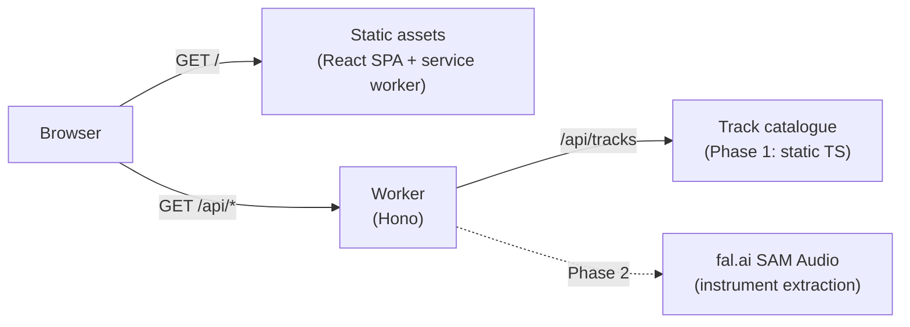

# 000. Architecture

**Status:** Phase 1 is playable with practice, MIDI input, pre-rendered keys and a PWA shell. Design: [`003. PHASE-1-DESIGN.md`](003.%20PHASE-1-DESIGN.md).

This document records the technical shape of the project and the decisions that later
phases should build on. It is deliberately short; per-phase design documents will carry
the detail.

## Product in one paragraph

A browser-based game where a player performs the melody of a backing track on an
instrument or with their voice. The browser captures the performance, compares it with a
pre-computed note chart, and produces a score that is forgiving of the player's natural
range.

## Stack

| Concern         | Choice                                 | Why                                                              |
| --------------- | -------------------------------------- | ---------------------------------------------------------------- |
| Runtime         | Cloudflare Workers + static assets     | One deployable, generous free tier, room for Phase 2 server work |
| Build           | Vite 8 with `@cloudflare/vite-plugin`  | Local dev runs the real Worker + Workerd environment             |
| UI              | React 19 + TypeScript                  | Component model fits the multi-screen game flow                  |
| Styling         | Tailwind CSS 4 via `@tailwindcss/vite` | Fast iteration, no runtime CSS-in-JS                             |
| API             | Hono                                   | Small, typed routing layer for `/api/*`                          |
| Tests           | Vitest + Playwright + axe              | Unit, API, IndexedDB, browser flow and accessibility checks      |
| Lint / format   | Biome                                  | One tool for TS, JSON and CSS                                    |
| Package manager | npm                                    | No extra tooling required                                        |

Workers was chosen over Pages because the project is a single application with a small
API surface. Static assets are served by Cloudflare's asset layer; the Worker only runs
for `/api/*`, which is pinned with `run_worker_first` in `wrangler.jsonc`.

## Request flow



- The app is a single page at `/`. Missing asset paths return a real 404
  (`not_found_handling: "404-page"`), so a missing MP3 or chart cannot be mistaken
  for the app shell.
- There is no CORS layer: client and API share an origin.
- There is no database in Phase 1. The track catalogue is a typed module in the Worker.

## Repository map

```
src/
  client/        React application (screens, game UI, browser storage)
  shared/        Types and pure helpers imported by both sides of the app
  worker/        Cloudflare Worker entry point and track catalogue
public/
  audio/         Backing tracks (Phase 1)
  charts/        Pre-computed note charts (Phase 1)
docs/            Architecture, prompts and per-phase design documents
```

Rules of thumb:

- `src/shared` must stay platform-neutral: no DOM, no Worker globals, no `fetch`.
- Audio and scoring code belongs under `src/client` and must not leak into the Worker.
- The Worker is allowed to own content metadata and, from Phase 2, file processing.
- Persistence is browser-only until a later phase explicitly adds a store.

## Browser audio pipeline (Phase 1)

1. Input is either `getUserMedia` with echo cancellation/noise suppression/AGC disabled,
   or Web MIDI note messages (`src/client/audio/pitch.ts`).
2. Microphone input uses a 4096-sample `AnalyserNode` sampled per animation frame; MIDI
   input emits note-on/off frames with an explicit onset flag.
3. `pitchy` (McLeod Pitch Method) produces `(timeSec, frequencyHz, clarity, level)` frames.
4. `usePerformance` schedules the selected pre-rendered key/backing/guide stems on the
   `AudioContext` clock and maps frames onto the chart plus octave fit.
5. `src/shared/scoring.ts` produces per-note pitch/timing/coverage scores with articulation
   and time-weighted coverage, then aggregates the result.

`src/shared/chart.ts` handles octave range fitting. Results are stored in IndexedDB;
profile and preferences stay in `localStorage`. The Settings screen can clear all local
data. The practice screen uses HTML audio elements (pitch-preserving speed) and a Web Audio
metronome, without requesting the microphone.

## Scoring principles (not yet specified)

The score must reward matching the reference melody without punishing a player for
having a different range. The design should cover:

- **Range forgiveness** — transpose the target melody into the chosen instrument's
  comfortable range rather than requiring the original key.
- **Pitch tolerance** — judge in cents, with a forgiving band and a smaller "perfect"
  band. Exact frequency matching is not a goal.
- **Timing** — onset windows rather than sample-perfect alignment, with partial credit
  for late/early notes.
- **Coverage** — reward holding notes for their intended duration and penalise long gaps.
- **Streaks / multipliers** — optional engagement layer; should not hide poor accuracy.

The proposed formula, weights and UI feedback are in [`003. PHASE-1-DESIGN.md`](003.%20PHASE-1-DESIGN.md).

## Persistence

Phase 1 keeps everything in browser storage:

- `localStorage` for the player name and last selected instrument/track.
- IndexedDB for local score history and personal bests.
- Nothing is sent to the Worker for storage. Phase 2 introduces server work for
  uploads, which will need an explicit retention and privacy design.

## Cloudflare deployment

- Account: `707690ff96207f8c8eeef44fb9995ac7` (free plan), pinned in `wrangler.jsonc`.
- Worker name: `music-performance`.
- `npm run deploy` builds and deploys to `music-performance.<account>.workers.dev`.
- `npm run cf-dry-run` validates the bundle without deploying.
- Free-plan request and CPU limits apply; the Phase 1 app should stay static-first, with
  the Worker reserved for catalogue metadata and future API calls.

## Testing

- Unit tests live next to pure modules (`src/shared/music.test.ts`).
- `npm test` runs Vitest once; `npm run test:watch` for development.
- Scoring, range fitting, pitch/MIDI source cleanup, loaders, content licences and results
  selection have Vitest coverage; the Hono API and IndexedDB are integration-tested.
  Playwright covers the full browser flow, practice/MIDI/key variants, mobile landscape and
  serious/critical axe violations. Content lock hashes, regenerated charts, variants and the
  catalogue are checked by `npm run content:validate`.
- Playwright uses synthetic microphone/MIDI input and Chrome/Chromium. `npm run test:coverage`
  enforces statement/line/function/branch thresholds in CI. Real-microphone,
  Safari/Firefox/iOS/Android and screen-reader checks are tracked in
  `docs/004. MANUAL-TESTING.md`.

## Phase 1 content integrity

`content/content.lock.json` pins source, voice-data, MIDI, chart and every key-variant
backing/guide hash. The validator regenerates each chart from `melody.mid`, deep-compares
catalogue entries to the lock, checks key variants and durations, and enforces the
public-domain/CC0/CC BY policy. Rendered audio uses the MIT-labelled FluidR3Mono soundfont (upstream licensing caveat
noted); its full notice is served at `/THIRD_PARTY_NOTICES.txt`. Legal review is pending.

## Phase 1 media decision

Phase 1 uses public-domain MIDI (Mutopia, Wikimedia Commons) and one original CC0
arrangement as the source of truth, renders melody-muted backing stems with FluidSynth
and the MIT-labelled FluidR3Mono soundfont, and derives charts from audited melody data.
See [`003. PHASE-1-DESIGN.md`](003.%20PHASE-1-DESIGN.md) for the track shortlist and the
full pipeline.

## Phase boundaries

- **Phase 1** — curated tracks, pre-computed charts, microphone capture, scoring,
  local results.
- **Phase 2** — user MP3 upload, instrument separation via fal.ai SAM Audio,
  server-side processing and chart extraction.
- **Phase 3** — productisation: accounts, persistence, teaching feedback, library,
  accessibility and performance work.

Do not pull Phase 2 infrastructure into Phase 1. The API boundary exists so that it can
be added later without restructuring the client.
