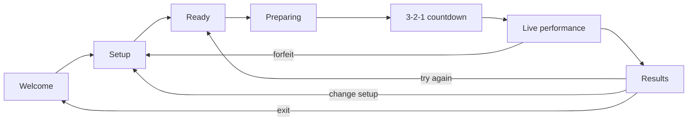

# 003. Phase 1 design — playable proof of concept

**Status:** approved and implemented; Phase 1.1 additions (practice, MIDI, keys, PWA, privacy) are in the same review cycle. Playtesting and tuning continue.

Phase 1 proves one thing: a player can perform a real melody in the browser, hear a
backing track, see live feedback, and receive a score that feels fair. Everything else is
secondary.

## Approved decisions

| Area              | Proposed decision                                                                       |
| ----------------- | --------------------------------------------------------------------------------------- |
| Media             | Start from public-domain MIDI, render our own backing stems, release the renders as CC0 |
| First tracks      | Twinkle (easy), Greensleeves (medium), Ode to Joy (medium), Bach Minuet (hard)          |
| Backing           | Melody muted in the backing stem; optional quiet guide-melody stem                      |
| Pitch detection   | `pitchy` (McLeod Pitch Method) behind a small `PitchDetector` abstraction               |
| Scoring           | Multiplicative: pitch quality × timing quality × note coverage                          |
| Range forgiveness | Transpose the chart into the instrument's comfortable range; vocal octave equivalence   |
| Persistence       | `localStorage` for preferences, IndexedDB for local results                             |
| Scope             | One complete vertical slice before adding more tracks or visual polish                  |

## 1. Goals and success criteria

- A first-time player can go from welcome to a completed performance without instructions
  outside the app.
- The backing track, chart and score stay in sync for the full track.
- Pitch feedback is stable enough on a clean voice or single-note instrument to feel
  responsive, not random.
- The score forgives range and intonation differences while still rewarding accuracy.
- Exiting mid-performance discards the score.
- All media is public domain or CC0, with provenance recorded in the repository.
- No audio leaves the browser. No server-side storage or accounts.

Success for the proof of concept:

- One track (Ode to Joy) works end to end in Chrome and Safari on desktop.
- A player can complete three runs in a row without a reload.
- Scores are reproducible for the same synthetic input.
- The content pipeline can add a new track from a MIDI file without touching game code.

## 2. Non-goals

- Polyphonic transcription or scoring chords.
- Audio upload, instrument separation, fal.ai, or any Phase 2 work.
- Accounts, cloud persistence, leaderboards.
- Multiple difficulty charts per track.
- Lyrics, karaoke-style word timing, or a full teaching curriculum.
- Perfect latency compensation on every device.

## 3. Media and licensing

### 3.1 Policy

Phase 1 uses **public domain or CC0** media only. CC BY is acceptable with clear
attribution, but was not needed for the chosen tracks. Avoid CC BY-SA, NC and ND assets so
that Phase 3 productisation is not constrained. The licence, attribution, source URL and
file hashes are recorded per track.

### 3.2 Verified sources

All links below were checked during design. Durations are measured from the downloaded
files; melody counts come from parsing the MIDI.

| Track                | Source                                                                                                                                                        | Licence                     | Duration                | Melody                                                     | Role            |
| -------------------- | ------------------------------------------------------------------------------------------------------------------------------------------------------------- | --------------------------- | ----------------------- | ---------------------------------------------------------- | --------------- |
| **Ode to Joy**       | [Mutopia SATB MIDI](https://www.mutopiaproject.org/cgibin/piece-info.cgi?id=528) + [Commons OGG](https://commons.wikimedia.org/wiki/File:Ode_to_Joy.ogg)      | Public domain               | 38.4 s MIDI, 38.6 s OGG | 62 soprano notes, D4–D5, G major, 100 BPM (`ode.ly` voice) | Reference track |
| **Twinkle Twinkle**  | Original 12-bar arrangement of the traditional melody; [Commons OGG](https://commons.wikimedia.org/wiki/File:Twinkle_Twinkle_Little_Star_plain.ogg) reference | PD melody / CC0 arrangement | 28.8 s                  | 42 notes, C4–A4, C major, 100 BPM                          | Easy track      |
| **Greensleeves**     | [Mutopia accordion MIDI](https://www.mutopiaproject.org/cgibin/piece-info.cgi?id=1265)                                                                        | Public domain               | 38.8 s                  | 72 onsets, E4–G5, explicit treble track                    | Medium track    |
| **Bach Minuet in G** | [Commons MIDI](https://commons.wikimedia.org/wiki/File:Bach_-_Minuet_in_G_Major.mid)                                                                          | Public domain               | 41.1 s                  | 127 onsets, D4–B5 (top voice)                              | Hard track      |

Evidence:

- `Ode_to_Joy.ogg` is explicitly described as the Mutopia MIDI converted to OGG by a
  Commons contributor, so audio and MIDI are aligned by construction. The measured
  duration difference of 0.18 s is encoder tail.
- The Ode source includes the LilyPond file `ode.ly` with explicit `sop`, `alto`, `tenor`
  and `bass` voices. The chart uses the 62-note soprano voice, not a heuristic top-voice
  extraction. A quick top-voice extraction of the MIDI yielded 67 onsets because it
  included inner voices; that is why the source voice matters.
- `GreensleevesAcc.mid` has a separate `treble` track (melody) and `bass` track
  (accompaniment), which makes chart extraction reliable.
- Twinkle is a new 12-bar arrangement of the public-domain melody, stored as
  `content/tracks/twinkle/voices.json`. The songbook MIDI found during research did not
  contain the expected melody, so it is not used. The Commons OGG is a public-domain
  reference only.
- Bach's MIDI is a piano arrangement with a top-voice melody; extraction works but needs
  a manual review because of ornaments and inner voices.

Rejected or deferred:

- FreePD is closed.
- Internet Archive results were predominantly CC BY-NC-SA or ND.
- Openverse's API did not respond during research.
- Commons and Mutopia MIDI/audio with CC BY-SA licences (for example the available
  Amazing Grace and Greensleeves guitar arrangements) were not used.
- `Greensleeves Correct Melody.ogg` is public domain but melody-only, so it is not a
  backing track.

### 3.3 Why render our own backing instead of using a recording

Using a public-domain recording is tempting, but it has three problems:

1. The melody is usually present in the mix. The microphone picks it up, which inflates
   the score unless the player uses headphones. Muting the melody is better.
2. Chart timings must be transcribed or aligned by hand.
3. Track choice is limited by what happens to exist as both audio and a clean MIDI.

Rendering from MIDI gives a clean accompaniment, exact chart timings, the option to
re-render in another key later, and a repeatable pipeline. The Ode OGG remains useful as a reference and fallback.

### 3.4 Rendering stack

- **FluidSynth 2.6** (LGPL, build-time only) renders the MIDI.
- **FluidR3Mono_GM.sf3** is the soundfont. The MuseScore distribution labels it MIT and
  includes required notices, but the upstream notice also says the collection’s licensing
  is under discussion. Treat “MIT” as provisional pending legal review. The soundfont is
  not committed; `content/SOUNDFONT-LICENSE.md` documents how to obtain it, and the render
  script verifies a pinned SHA-256 before using it.
- Audio is rendered at 44.1 kHz, normalised to roughly -18 LUFS integrated with a -1 dB
  true-peak ceiling, and encoded to 128 kbps MP3.
- The rendered performance is released as **CC0**. The complete MIT soundfont notice and
  sample-credit notices are served at `public/THIRD_PARTY_NOTICES.txt` and reproduced in
  `content/SOUNDFONT-LICENSE.md`; the track manifests carry a short soundfont label.
- Each track may ship two stems: `backing.mp3` (the dedicated melody track is muted;
  harmony may still contain the same pitch classes) and `guide.mp3` (melody only, played
  quietly and off by default).
- For SATB sources such as Ode, the soprano shares a MIDI track with the alto. Render the
  stems from the LilyPond source (`guide` = soprano, `backing` = alto + tenor + bass)
  rather than muting the whole upper staff. Greensleeves has separate treble and bass
  tracks; Twinkle is generated from its own `voices.json` melody, chord and bass voices.

Rendering was verified during design: the Ode accompaniment rendered to a 41.8 s WAV
(38.4 s of music plus reverb tail), and an OGG-to-MP3 conversion produced a 604 KB file.

## 4. Content pipeline

### 4.1 Repository layout

```
content/
  SOUNDFONT-LICENSE.md
  content.lock.json   # source, MIDI, chart and audio hashes
  tracks/ode-to-joy/
    track.json          # metadata, licence, melody source, difficulty
    source.mid          # public-domain source MIDI (full arrangement)
    source.ly           # original LilyPond source when available
    voices.json         # audited note data for generated arrangements
    melody.mid          # audited melody voice only, used for the chart
    backing.mid         # accompaniment with the melody track muted
    LICENSE.md          # provenance and attribution
  tracks/twinkle/
  tracks/greensleeves/
scripts/content/
  build.ts      # render stems, charts, catalogue, content.lock.json
  midi.ts       # MIDI parser/writer and track extraction
  chart.ts      # melody MIDI -> chart JSON
  catalogue.ts  # catalogue entry/rendering
  licence.ts    # Phase 1 licence policy
  model.ts      # manifests, lock and paths
  validate.ts   # hashes, regenerated charts, catalogue, licences
public/
  audio/<id>.backing.mp3
  audio/<id>.guide.mp3   # optional
  charts/<id>.json
  THIRD_PARTY_NOTICES.txt
  404.html
```

Source MIDI/voices, manifests, `content.lock.json`, rendered MP3s and charts are committed
so the Worker deployment does not need FluidSynth. The 23 MB soundfont is not committed;
its licence and download instructions live in `content/SOUNDFONT-LICENSE.md`.

### 4.2 Chart extraction

1. Every track has an audited `melody.mid` containing only the reference voice. This is
   the single source of truth for the chart.
2. Create `melody.mid` from an explicit source voice:
   - Ode: the `sop` voice in `ode.ly`.
   - Greensleeves: its dedicated `treble` track.
   - Twinkle: the original `melody` voice in `voices.json`.
   - Bach: highest-voice extraction followed by a manual review, because the source is a
     piano arrangement with inner voices.
     For Mutopia LilyPond sources, either render the voice with LilyPond or transcribe it
     into `melody.mid`; the committed file is the audited artifact. Do not rely on a
     heuristic when an explicit voice exists.
3. Parse `melody.mid` with a small, dependency-free parser (standard MIDI, tempo map,
   note-on/off, running status).
4. Convert ticks to seconds using the tempo map. Do not quantise; preserve the source
   timing.
5. Drop notes shorter than 80 ms. Do not merge separate note-ons: repeated pitches are
   real notes and must stay in the chart. Keep the original order.
6. Clamp the last note to the audio end; ensure every note falls inside the audio.
7. Write `public/charts/<id>.json` with `version`, `trackId`, `sourceInstrument`,
   `tempoBpm`, optional `keySignature`, and `notes`.
8. Run the validator before every commit.

### 4.3 Track manifest

```json
{
  "id": "ode-to-joy",
  "title": "Ode to Joy",
  "artist": "Ludwig van Beethoven",
  "difficulty": "medium",
  "sourceInstrument": "vocals",
  "licence": "Public domain",
  "audioLicence": "CC0 1.0",
  "soundfont": "FluidR3Mono_GM (see THIRD_PARTY_NOTICES; legal review pending)",
  "attribution": "Composition: Ludwig van Beethoven. MIDI and LilyPond: Mutopia Project (public domain).",
  "sourceUrl": "https://www.mutopiaproject.org/cgibin/piece-info.cgi?id=528",
  "source": "source.ly",
  "sourceSha256": "<hash>",
  "sourceMidi": "source.mid",
  "sourceMidiSha256": "<hash>",
  "melody": { "source": "melody.mid", "voice": "sop" },
  "render": {
    "kind": "voices",
    "voicesFile": "voices.json",
    "guideVoices": ["sop"],
    "backingVoices": ["alto", "tenor", "bass"],
    "tailSec": 1.5
  },
  "keySignature": "G major",
  "tempoBpm": 100
}
```

The build step generates the audio/chart URLs, the `TrackSummary` entries consumed by the
Worker, and `content/content.lock.json` with artifact hashes. The catalogue and lock are
never hand-edited separately from the source manifest.

### 4.4 Twinkle arrangement

Twinkle ships as a complete 12-bar arrangement (28.8 s at 100 BPM), not a loop of the
9.9 s songbook MIDI. `voices.json` contains the melody, chords and bass; the build script
renders a guide stem and a melody-muted backing stem, and derives the 42-note chart from
the melody.

## 5. Player experience

### 5.1 Flow



### 5.2 Setup

- Name, instrument, track.
- Track cards show title, artist, duration, difficulty, key/tempo and licence.
- If a guide stem exists, a "Guide melody" toggle (default off) with a volume hint.
- A headphone recommendation, because the backing can bleed into the microphone.
- The ready screen has the Start button. Start loads the chart/audio, requests the
  microphone and resumes the AudioContext before the countdown; missing assets or denied
  permission produce an error screen with retry.
- Retry from results returns to the ready screen with the same settings.

### 5.3 Preparing and countdown

- Fetch the chart, fetch/decode the backing (and guide only when enabled) into an
  `AudioBuffer`, request the microphone, and resume the `AudioContext` inside the user
  gesture.
- Show a "Preparing the stage" spinner while the assets and permission resolve.
- Countdown 3-2-1. The audio start time is scheduled exactly one second after "1".
- A cancel action before audio starts returns to setup without a result.

### 5.4 Live performance

- A pitch lane shows upcoming target notes scrolling toward a playhead.
- Current target note name and a cents needle are visible, plus recent note ratings.
- Score, accuracy, streak and a progress bar update while playing.
- Note blocks use a colour and a rating symbol (★ ✓ • ×) so colour is not the only
  signal.
- The backing stem plays; the guide stem is optional.
- A "Forfeit" control is always visible. Opening the confirm dialog pauses the
  AudioContext and timer; "Keep playing" resumes, and confirming stops audio and discards
  the score.
- Keep the tab visible; a hidden tab loses animation frames and therefore misses notes.

### 5.5 Results

- Score out of `100 × note count`, accuracy percentage, pitch/timing/coverage breakdown.
- Notes hit/missed, longest streak, and a per-note strip showing where errors clustered.
- Clean local best for this track + instrument + octave shift; guide-assisted runs are saved separately.
- Try again (ready screen, same settings), change setup, exit.
- No result is recorded for a forfeited run.

## 6. Audio engine and synchronisation

- One `AudioContext` owns both playback and analysis.
- Audio is fetched and decoded before the performance starts. A 40 s MP3 decodes to about
  7 MB of float samples, which is acceptable for Phase 1.
- Playback uses `AudioBufferSourceNode` scheduled at `audioContext.currentTime + 3`.
  The context clock is the master clock; UI animation reads
  `audioContext.currentTime - startTime`.
- Backing and guide each pass through a `GainNode`. The guide is off by default; when
  enabled it plays at about -12 dB.
- Microphone graph: `getUserMedia` → `MediaStreamAudioSourceNode` → `AnalyserNode`.
  The analyser is not connected to the destination, so there is no feedback loop.
- Constraints: `echoCancellation` is configurable and on by default, `noiseSuppression:
  false`, `autoGainControl: false`, mono. The raw path preserves musical detail but lets a
  speaker mix bleed into the microphone, so echo cancellation is the default and the UI
  explains when to turn it off for headphones.
- Forfeiting calls `source.stop()`, disconnects the input and closes the context and
  microphone stream. A retry creates a fresh context and input source.
- `AudioContext.resume()` must happen in the Start gesture to satisfy autoplay policies.

Frame timestamps are corrected to the centre of the 4096-sample analysis window and by
the browser-reported input-track latency. Remaining per-device latency is absorbed by the
generous timing windows; a calibration screen is deferred until playtesting shows a
consistent bias. Wired headphones are recommended; Bluetooth adds latency.

## 7. Pitch detection

- Use [`pitchy`](https://github.com/ianprime0509/pitchy) (McLeod Pitch Method) on
  4096-sample time-domain windows, sampled from an `AnalyserNode` on each animation frame.
- Detection range: 50 Hz to 2 kHz, covering all Phase 1 chart ranges. Results outside
  that range are discarded.
- Minimum input RMS is 0.003. This deliberately rejects room rumble and quiet speaker bleed;
  `pitchy`'s `minVolumeDecibels` uses a power ratio, so the absolute RMS setter is used.
- Each frame is `{ timeSec, hz, clarity, level }` where `timeSec` comes from the
  `AudioContext` clock (window-centre corrected), not `performance.now()`; `level` is RMS
  used for repeated-note articulation.
- The MPM clarity constant is 0.9 (the library's recommended range is 0.8–1.0) to prefer
  the fundamental over strong harmonics. Scoring rejects frames below 0.75.
- Apply a median-of-5 smoothing filter to the cents values before scoring; this handles
  vibrato and frame outliers without hiding a consistently wrong pitch.
- The live lane smooths absolute pitch, not target-relative cents, with a median-of-3 plus a
  time-based easing filter (70 ms time constant), and holds the last voiced value for 180 ms
  through brief low-confidence frames. The filter carries across note changes.
- Vocal octave equivalence is a run-level offset. It locks only after four notes whose pitch
  class matches the target within 80 cents, and is never recomputed from the current target,
  so a target change cannot move the ball by an octave. The calibration target is chosen from
  the frame's corrected timestamp, not the current playhead.
- The lane uses a symmetric five-semitone margin and no longer folds out-of-range pitches.
  An out-of-range ball is clamped to the edge and marked with an amber ring instead of
  disappearing or teleporting to the centre. Low-confidence frames still update the display
  at a 0.5 clarity threshold (scoring keeps 0.75), and the last value is held for 400 ms so
  consonants and brief detector dropouts do not make the ball flicker.
- This is display-only; scoring still uses the raw frame data.
- Keep the detector behind a narrow interface:
  `PitchDetector.detect(buffer: Float32Array, sampleRate: number): PitchFrame | null`.
  This leaves room to replace MPM with an AudioWorklet, YIN or CREPE later.
- Add a microphone-check screen that shows detected frequency, cents and clarity, and lets
  players verify the detector with a tuner or reference tone before a run.
- Vocals may use octave folding (see scoring); instruments do not.

The first implementation can poll the analyser with `requestAnimationFrame`. If frame
timing or latency proves inadequate, move the capture into an `AudioWorklet` with a
ring buffer and timestamped frames.

## 8. Scoring

### 8.1 Model

For each chart note, after applying the octave fit:

```
noteScore = 100 × pitchQuality × timingQuality × coverage
```

- `pitchQuality` averages the per-frame pitch score across frames where a confident pitch
  was detected.
- `timingQuality` measures how close the first credible onset is to the target start.
- `coverage` is the fraction of the note window with a confident voiced pitch.
- A silent note has coverage 0 and therefore scores 0.
- A pitch far from the target (more than ~250 cents) gets 0 pitch quality; a near miss
  gets partial credit rather than an automatic zero.
- A correct pitch started 200 ms late still earns partial timing credit.

Total score = sum of note scores. Maximum = `100 × note count`. Accuracy = total / maximum.

### 8.2 Pitch bands

`d` is the absolute deviation in cents, after vocal octave folding.

| `d` (cents) | Pitch score |
| ----------- | ----------- |
| 0–30        | 1.00        |
| 30–80       | 1.00 → 0.65 |
| 80–150      | 0.65 → 0.10 |
| 150–250     | 0.10 → 0.00 |
| >250        | 0.00        |

The bands are deliberately wide. A singer who is 40 cents sharp should not be treated the
same as one who is a semitone off. The numbers are starting values and must be tuned in
playtesting.

### 8.3 Timing

For a new pitch, the onset is the frame closest to the target start in
`[note.start - 300 ms, note.start + 500 ms]` with a pitch score of at least 0.25 and
sufficient clarity. The relaxed threshold lets a slightly out-of-tune note earn partial
credit; its pitch quality still carries the penalty. For adjacent notes of the same pitch,
a sustained tone is not a new onset: timing requires a level dip or rise
(re-articulation) near the boundary.

| Absolute onset error | Timing score |
| -------------------- | ------------ |
| 0–120 ms             | 1.00         |
| 120–300 ms           | 1.00 → 0.50  |
| 300–500 ms           | 0.50 → 0.00  |
| >500 ms or no onset  | 0.00         |

Frames are ignored outside note windows, so silence between phrases is not penalised.

### 8.4 Coverage and note windows

- Expected window: `[start, end]`.
- Pitch quality ignores the first 80 ms of each note (to allow scoops/attacks) and the
  last 50 ms (release), unless the note is shorter than 250 ms.
- Coverage is time-weighted from frame timestamps, capped at 100 ms per sample, so a stalled
  animation loop cannot turn a long silent gap into full coverage. A dropped frame does not
  change the score merely by changing the sample count.
- Coverage counts the whole note, so stopping early reduces the score.
- Short notes below 80 ms are removed during chart extraction.

### 8.5 Ratings and streak

| Note score | Label   |
| ---------- | ------- |
| ≥ 90       | Perfect |
| ≥ 75       | Great   |
| ≥ 50       | Good    |
| < 50       | Miss    |

A streak counts consecutive notes scoring at least 50. Phase 1 displays the streak but
does not add a score multiplier; multipliers make results harder to compare while the
tolerances are still being tuned.

### 8.6 Range forgiveness

- Charts store sounding (concert) pitch. At performance time, choose an octave shift so
  the melody fits the selected instrument's comfortable range. Phase 1 is octave-only
  because the backing audio is not pitch-shifted; a semitone shift would move the target
  out of the backing track's key. Guitar sounds an octave below written notation; the UI
  labels note names as concert pitch.
- Prefer 0, then the octave shift that minimises out-of-range notes, with the smallest
  absolute shift winning ties. If the melody is wider than the range, choose the shift
  with the fewest unreachable notes and show a warning.
- Display the chosen shift ("Fitted down an octave") before the performance.
- **Vocals** additionally allow octave equivalence: a pitch an octave away from the
  target is folded into the same pitch class. This handles bass/baritone singers without
  changing the chart. Instruments require the written octave.
- Do not compress intervals or change the melody's contour.

Phase 1's chosen melodies already fit all five instrument ranges, so the octave fit will
usually be 0. The algorithm still ships because it is a product requirement and is
straightforward to test.

### 8.7 Worked example

Target: A4 (440 Hz), duration 0.5 s. The player starts 90 ms late, sings between 430 and
450 Hz until the note ends, and then stops.

- Pitch deviation: −40 to +39 cents. Average pitch score ≈ 0.86.
- Timing error 90 ms: timing score 1.0.
- Coverage: the 90 ms late start leaves 0.41 s of voiced pitch in a 0.5 s window, so 0.82.
- Note score ≈ 100 × 0.86 × 1.0 × 0.82 = **70.5** → Good.

This is intentionally forgiving: a slightly late, slightly flat note still lands in the
Good band rather than failing outright.

### 8.8 Calibration plan

Tune the bands and windows in this order:

1. Synthetic tones at known cents offsets and timings (unit tests).
2. Recorded clean instrument takes at known pitches.
3. Playtests with 3–5 people across voice and one instrument.
4. Adjust for consistent bias (for example, all singers score 20% low because of input
   latency or scoops) before touching the pitch bands.

## 9. Data and persistence

- Preferences (profile and last instrument/track) use versioned `localStorage` keys; the
  guide choice travels in the performance config.
- Results use IndexedDB with note-level breakdowns. Keep the latest 100; clean personal
  bests are keyed by track, instrument and octave shift. Guide-assisted runs are saved but
  do not set the clean best.
- Persistence failures must never block gameplay; the current result stays in React state.
- All records stay in the browser. The Privacy & data screen clears local preferences,
  results/bests, caches, diagnostics and service-worker registrations as a best-effort
  operation, reporting partial failures.

## 10. API and content validation

- `GET /api/tracks` returns catalogue summaries. Charts and audio remain static assets.
- `GET /api/health` stays for smoke tests.
- No new API routes are needed in Phase 1.
- `npm run content:validate` fails on:
  - missing source, voices, melody/backing MIDI, chart, audio or notices files;
  - any source, voices, MIDI, chart or MP3 hash mismatch against
    `content/content.lock.json`;
  - a chart that does not reproduce exactly from `melody.mid`;
  - unsorted or overlapping notes, or notes outside the performance duration;
  - stale lock/catalogue fields or a catalogue that does not deep-equal the lock;
  - licences outside public domain/CC0/CC BY, non-CC0 rendered audio, missing
    attribution/source URL or missing soundfont label.
- Run it in `npm run build` and in CI when CI exists.

## 11. Accessibility and mobile

- The countdown uses an assertive live region; the results heading is focused; the live
  score is not announced on every frame.
- Note ratings use symbols as well as colour; results expose a screen-reader note list.
- Respect `prefers-reduced-motion` with a static target/cents card instead of the moving
  lane, and disable decorative animation.
- Keyboard: Tab to controls, Space/Enter to start, Escape opens the forfeit dialog;
  the native modal traps/restores focus.
- Focus moves to the results heading; returning to setup focuses the main region (the
  track list is the next interactive content).
- Mobile: request a mono microphone, handle permission denial, keep the Start button
  below the fold-free stage, and warn that Bluetooth headphones add latency.
- Test on iOS Safari: AudioContext resume, permission prompt, and `decodeAudioData`.

## 12. Testing

- Unit tests: music maths (already present), chart validation, octave fitting/range fit,
  pitch band function, onset/timing function, full note scoring.
- Synthetic frame tests: exact pitch, flat/sharp, silence, wrong octave, late onset,
  short hold, vibrato, low clarity.
- Detector tests: generate sine waves at known frequencies in Node and assert pitchy is
  within ±5 cents at clarity ≥ 0.9 for clean tones.
- Content tests: the committed charts reproduce exactly from `melody.mid`; Ode has 62
  notes, Twinkle 42 (C4–A4), Greensleeves 72; tempo extraction, short-note filtering and
  overlap rejection are covered. The content lock pins source, MIDI, chart and audio
  hashes and the validator deep-compares the catalogue.
- Manual matrix: Chrome, Safari, Firefox on macOS; iOS Safari; one Android Chrome device.
- Performance check: 60 fps UI while analysing audio on a mid-range laptop.

## 13. Milestones

| Milestone | Deliverable                                                               |
| --------- | ------------------------------------------------------------------------- |
| M0        | Media research and rights shortlist (this document)                       |
| M1        | Content pipeline: render stems for 3 tracks, generate and validate charts |
| M2        | Audio engine + microphone capture + microphone-check screen               |
| M3        | Scoring engine with unit tests, independent of UI                         |
| M4        | End-to-end vertical slice on Ode to Joy (countdown → score → results)     |
| M5        | Persistence, forfeit, retry, loading/error states                         |
| M6        | Add Twinkle and Greensleeves; tune from playtests                         |
| M7        | Accessibility, mobile pass, polish; update architecture and track docs    |

M1 and M2 can overlap once the first track renders. Do not start M4 until the scoring
engine and content validator pass their tests.

## 14. Risks and open questions

- **Backing bleed.** A microphone will hear speakers. Headphones are recommended; the
  melody is muted in the backing; a guide stem is optional. If bleed is still a problem,
  add a "headphones required" gate in a later phase.
- **Detector accuracy on breathy vocals.** MPM may struggle with quiet or noisy voices.
  The microphone check and the abstraction boundary are there to swap in CREPE or an
  AudioWorklet.
- **Latency.** Generous windows hide small offsets, but Bluetooth and some Android devices
  can exceed them. Calibration is deliberately deferred until measured.
- **Melody extraction from polyphonic MIDI.** Highest-voice extraction is a heuristic and
  can pick up inner voices. The pipeline therefore uses an audited `melody.mid` created
  from an explicit source voice wherever one exists; only Bach still needs manual review.
- **SATB stem rendering.** Ode needs voice-aware rendering (LilyPond or a voice-aware MIDI
  export). If that is fiddly, the aligned full-mix OGG is a fallback, but it requires
  headphones to avoid microphone bleed.
- **Soundfont licensing.** FluidR3Mono is labelled MIT and requires notices in derivatives,
  but the upstream notice says licensing may change. Legal sign-off is required before
  public release.
- **Playtest tuning.** The score formula and bands are guesses. They will change after
  real players use them.
- **Guide stem default.** Off is safer for scoring; on is friendlier for beginners. Start
  off and expose the toggle.
- **Twinkle repetition.** The 12-bar arrangement is short; playtesting will decide whether
  to add a repeat or a variation.
- **Score display.** Sum of 100-point notes is easy to reason about, but may feel less
  exciting than a 10,000-point total. Decide after the first results screen.
- **Tuning.** A440 is assumed. Acoustic instruments tuned flat will lose points; a tuning
  calibration is out of scope for Phase 1.
- **iOS Safari.** Audio capture and context lifetime need device testing.

## Appendix A: research notes

- FreePD: site closed.
- Internet Archive advanced search: results dominated by CC BY-NC-SA and ND licences.
- Openverse audio API: timed out during research; revisit for Phase 2.
- Wikimedia Commons: strong source of PD MIDI and PD OGG files with machine-readable
  licence metadata.
- Mutopia: PD MIDI generated from LilyPond sources, with explicit per-piece licences.
- FluidR3Mono_GM.sf3: MIT-labelled soundfont distributed with MuseScore; about 23 MB;
  suitable for offline rendering, not for shipping in the browser. Legal review is pending
  because the upstream notice says licensing may change.
- Verified Ode melody: the `sop` voice in `ode.ly` has 62 notes, range D4–D5, in G major
  at 100 BPM. First phrase: B4 B4 C5 D5 D5 C5 B4 A4 G4 G4 A4 B4 B4 A4 A4.
- Verified Greensleeves melody: 72 onsets, E4–G5, `treble` track, `bass` accompaniment.
- Twinkle arrangement: 42 notes, C4–A4, 28.8 s at 100 BPM, original chords and bass.
- Bach Minuet: the right-hand track was reduced to a 127-note highest-voice melody,
  D4–B5, with the left hand as backing. It is the hard track and remains a heuristic
  reduction rather than a hand-audited transcription.

## Appendix B: links

- Ode MIDI: <https://www.mutopiaproject.org/ftp/BeethovenLv/ode/ode.mid>
- Ode OGG: <https://upload.wikimedia.org/wikipedia/commons/f/f7/Ode_to_Joy.ogg>
- Greensleeves MIDI: <https://www.mutopiaproject.org/ftp/Traditional/GreensleevesAcc/GreensleevesAcc.mid>
- Twinkle reference: <https://upload.wikimedia.org/wikipedia/commons/b/bd/Twinkle_Twinkle_Little_Star_plain.ogg>
- Bach Minuet MIDI: <https://upload.wikimedia.org/wikipedia/commons/a/ab/Bach_-_Minuet_in_G_Major.mid>
- FluidR3Mono licence: <https://github.com/musescore/MuseScore/blob/main/share/sound/FluidR3Mono_License.md>
- FluidSynth: <https://www.fluidsynth.org/>
- pitchy: <https://github.com/ianprime0509/pitchy>

## Appendix C: implementation notes (2026-10-25)

- Content pipeline: `scripts/content/midi.ts`, `build.ts` and `validate.ts`; run
  `npm run content:build` and `npm run content:validate`. Rendered stems and charts are
  committed so normal builds do not need FluidSynth.
- Ode: 62 soprano notes from `sop` in `ode.ly`; stems are soprano (guide) and
  alto/tenor/bass (backing).
- Twinkle: original 12-bar `voices.json` arrangement; 42 notes, 28.8 s.
- Greensleeves: 72 treble notes, bass backing, 38.8 s of music.
- Scoring lives in `src/shared/scoring.ts`; range fitting in `src/shared/chart.ts`.
  The onset near-miss threshold shipped at 0.25 pitch score rather than 0.5, so a
  slightly out-of-tune note earns partial credit instead of failing outright.
- Browser audio: `src/client/audio/pitch.ts` (MPM via pitchy),
  `src/client/audio/loadPerformance.ts`, and `src/client/game/usePerformance.ts`.
- Results are stored in IndexedDB (`src/client/lib/results.ts`).
- A microphone check is reachable from the welcome screen and at `#/pitch-lab`.
- Twinkle uses a new arrangement because the songbook MIDI sourced during research did
  not contain the expected melody. It remains PD melody / CC0 arrangement.
- Review fixes: startup microphone cleanup is abort-safe; forfeit pauses the AudioContext;
  the pitch lane follows `prefers-reduced-motion`; ratings use symbols as well as colour;
  frames carry RMS level and a window-centre timestamp; repeated same-pitch notes require
  re-articulation for timing credit; coverage is time-weighted; the content lock/validator
  covers source, artifacts, catalogue and licence policy; soundfont notices are served;
  and note names/ranges are explicitly concert pitch.

## Appendix D: Phase 1.1 additions

These were added after the independent review and the follow-up backlog.

- **Runtime hardening:** API/chart runtime validators and a React error boundary; local
  session diagnostics with copy/clear actions.
- **Inputs:** Web MIDI keyboard input alongside the microphone, with explicit note-on
  onset frames; microphone startup is abort-safe.
- **Timing and mix:** manual timing offset, backing/guide volume settings, explicit pause
  and resume, and a paused timer.
- **Keys:** pre-rendered -2/0/+2 semitone backing and guide variants for every track,
  selected in setup. Octave fitting remains additional; all variants are hashed in the
  content lock and validated.
- **Content:** Bach Minuet hard track (highest-voice reduction, left-hand backing), Twinkle
  lyrics, and per-track GM programs (piano, music box, harpsichord) for timbral variety.
- **Practice:** a no-microphone practice screen with whole-track loop, guide-only mix,
  metronome and 50/75/100% pitch-preserving speeds, plus current/upcoming note feedback.
- **History/share:** local history and personal-best tables, result sharing via Web
  Share/clipboard, clean-best filtering excluding guide-assisted runs, and 100-result
  retention.
- **Privacy:** a Privacy & data screen showing storage contents, audio levels, timing offset,
  diagnostics and a full local-data clear action. No analytics or remote error reporting.
- **PWA/security:** installable manifest, offline service worker (shell, catalogue, played
  audio), `404-page` asset handling, hash deep links, CSP, Permissions-Policy,
  Referrer-Policy, frame protections and static-asset cache headers.
- **Polish:** 3-2-1 count-in clicks, rating animation, confetti, phrase-score trend, selected
  track/chart preloading, range-fit preview, microphone check, reduced-motion static lane,
  and mobile-safe-area/landscape handling.
- **Tests:** Hono API tests, fake-IndexedDB integration, game-lifecycle hook tests,
  PitchLab cancel/abort tests, component tests for results/history/settings/error handling,
  negative content-validator tests, MIDI/practice/scoring edge cases, Playwright
  smoke/MIDI/practice/key variant/clear-data/error/denial/mobile tests, axe audits, a
  production offline PWA test and enforced coverage thresholds. Real-device,
  real-microphone and screen-reader checks are tracked in `docs/004. MANUAL-TESTING.md`.
